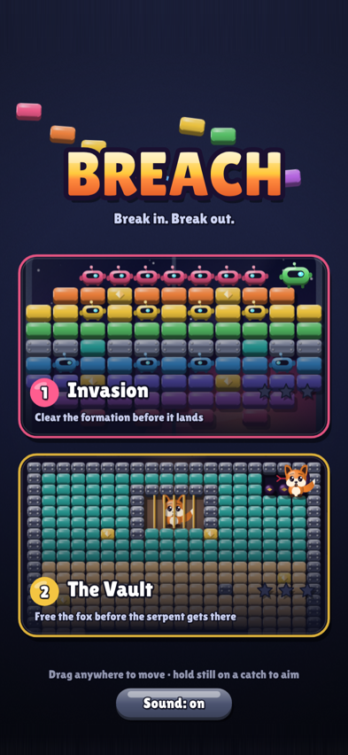
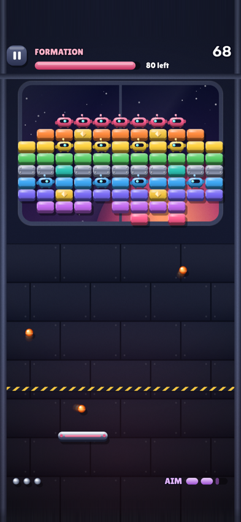
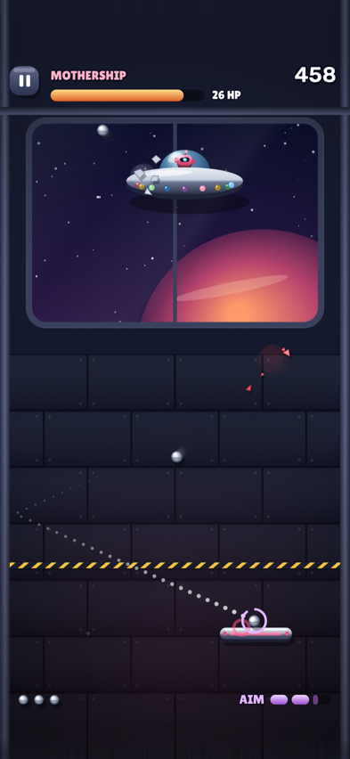
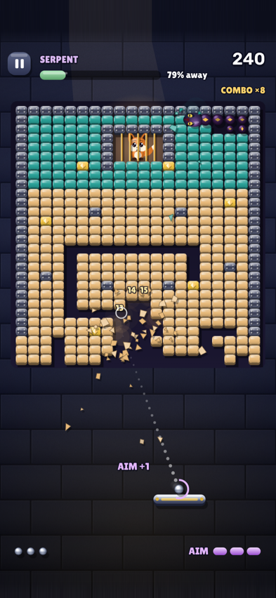
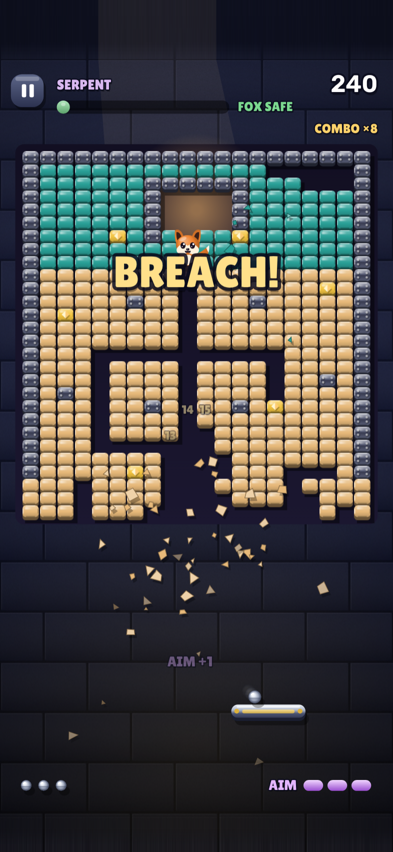
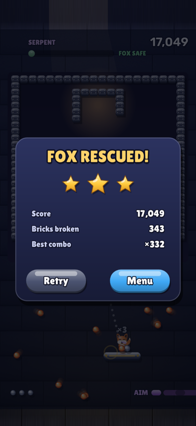

# BREACH

A premium brick breaker for iPhone and Android. Glossy toy-like art, real ball physics, lots of power-ups, and levels built around a race against the clock.

## Play the prototype

```
npm install
npm run build        # writes dist/breach.html, a single self-contained file
open dist/breach.html
```

Or serve the folder and open `index.html` (ES modules, no build step). `npm test` runs the physics tests.

Controls: drag anywhere to move the paddle. Before a serve, drag to aim and release to launch. Hold your thumb still as the ball lands to catch it in slow motion and aim the next shot (limited by the AIM meter). Swipe the paddle as you hit to curve the ball. Keyboard: arrows and space.

## Levels

1. **Invasion.** A marching formation of candy bricks and toy robots steps down toward your line. Robots shoot bolts that stun the paddle. Clear the formation before it touches the hazard line, then take down the mothership.
2. **The Vault.** A fox is trapped in a cage inside a brick vault. A serpent chews its way toward it. Carve a tunnel from the bottom to the cage first, stun the serpent with the ball, then enjoy the frenzy as the structure collapses.

| Menu | Invasion | Mothership |
|---|---|---|
|  |  |  |
| **Focus aim** | **Breach** | **Results** |
|  |  |  |

## Code

| File | What it does |
|---|---|
| `src/physics.js` | Fixed-step, substepped ball vs brick grid, walls and paddle. No DOM. |
| `src/arena.js` | Shared gameplay: paddle, serve and Focus aim, power-ups, combo, lives, screen shake. |
| `src/invasion.js` | Level 1. |
| `src/vault.js` | Level 2. |
| `src/gfx.js`, `src/characters.js` | Glossy rendering helpers, particles, robots, fox, serpent, mothership. |
| `src/audio.js` | Synthesized sound effects. |
| `src/main.js` | Canvas sizing with safe-area insets, game loop, input, menu and results screens. |

The design plan is in [docs/GAME_PLAN.md](docs/GAME_PLAN.md).
