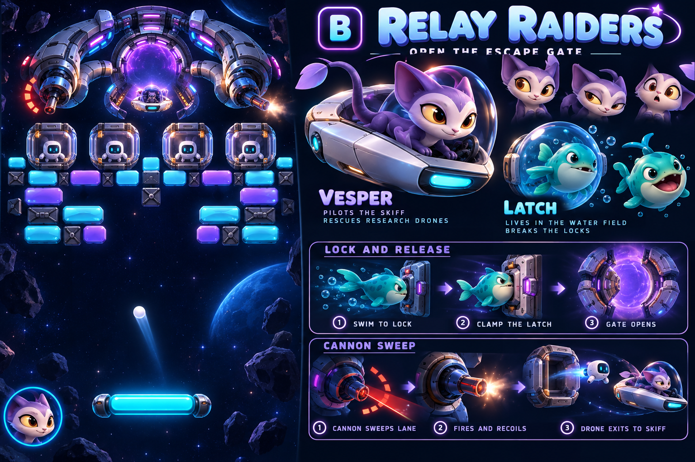
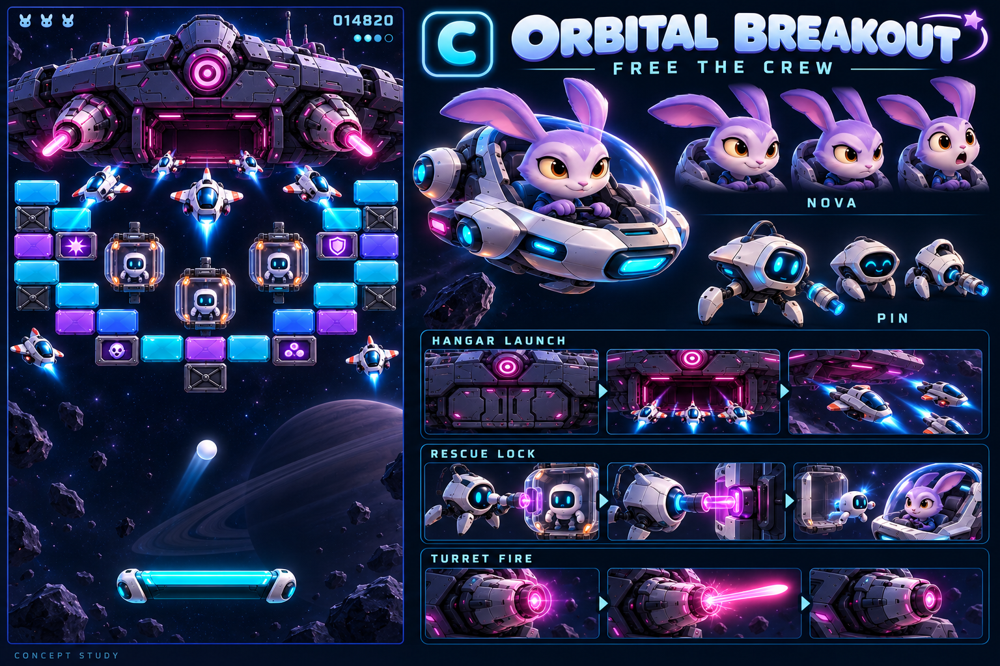
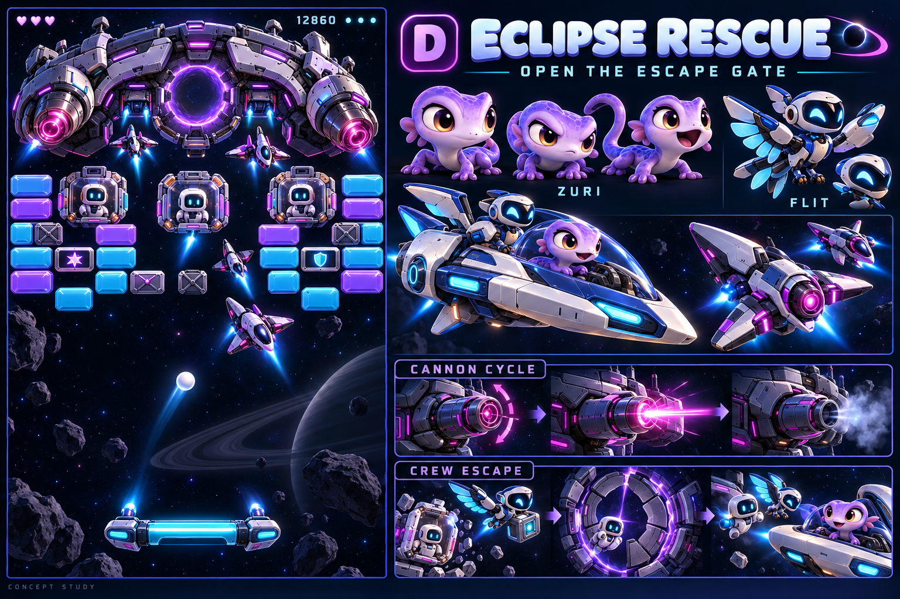
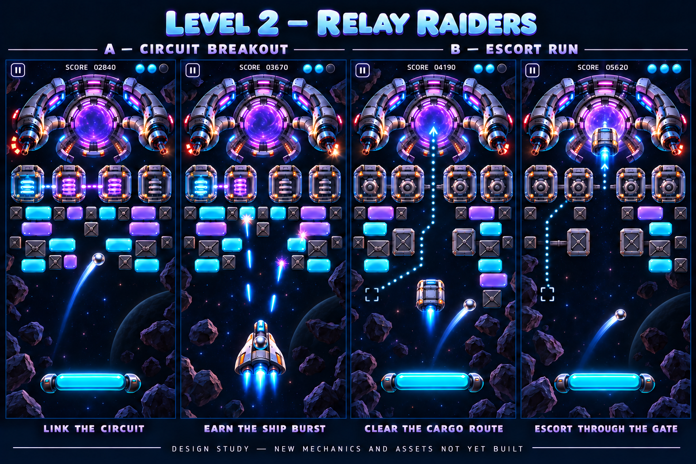
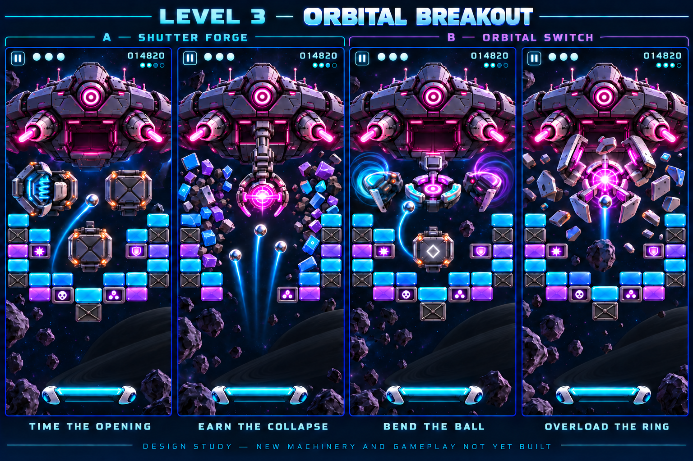

# Space design boards

Preserved originals; these links remain usable if a working source changes. Carrier A, Circuit A and Forge A are selected directions. Eclipse D and the alternate later gameplay directions remain references.

## Carrier Breakout — A

## Relay Raiders — B

## Orbital Breakout — C

## Eclipse Rescue — D

## Circuit gameplay alternatives

## Forge gameplay alternatives

