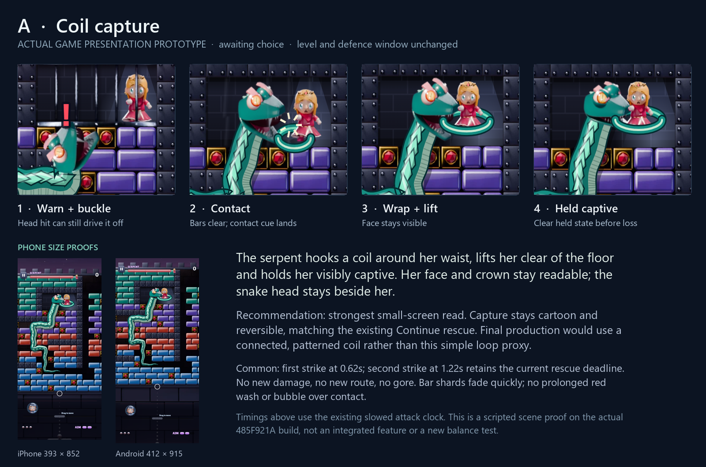
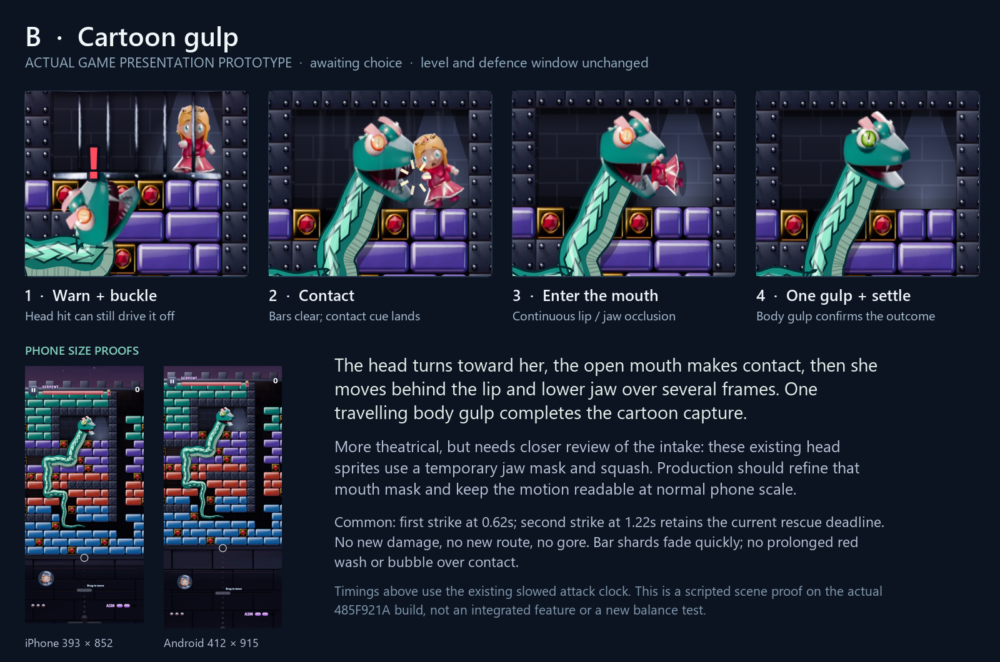

# Princess capture presentation options

The owner accepted the level/playability and rejected the old serpent capture because the characters overlapped without a readable hit, catch or swallow. **A / connected coil capture is selected. Native Vault source is implemented and frozen for the combined build; final combined phone verification is pending. B remains unselected.** The approved route, damage, venom, entrance and physics remain unchanged. No primary commit or push is approved.

The earlier prototype used the actual packed game and its existing princess/jade head sprites. Its base SHA256 was **485F921A73977C325E535A3500CEA967CB00B16A63042D15110F4D2D31073DF0**. Files under `out/capture-prototype/` remain throwaway presentation overrides and scripted captures, never production imports.

## Selected native implementation

The second strike still commits at1.22 attack seconds. At that moment the scene records the actual approach, first three body points and princess position. The captive anchor mirrors according to the approach: Lumi settles atx200 with the head beside her at(164,164), or atx160 with the head at(196,164). She stops normal pacing and lifts from floor feet191 to181. Head and leading neck turn into the pose together; later body points retain their existing route positions.

The capture is one continuous native body ribbon with the existing jade material, belly, diamond markings, highlights and outline. Its leading section curls around Lumi, narrows for the hold, and blends back into the body. The full ribbon draws behind her, then the front section of that **same ribbon** draws in front of her lower torso. It is not the proposal's separate oval loop. Her crown/face remain in front of the rear section, and the head stays beside them. A small contact cue at1.62–1.79s follows the closing grip. The turn completes at1.68s and lift at1.88s; the held pose remains visible until the existing2.7s loss.

Only fragments created by the capture's cage burst receive a0.38-second lifetime. Unrelated brick debris keeps its normal lifetime. The prolonged red wash, giant GOT HER label and caught-phase speech bubble are removed. The first strike0.62s and second strike1.22s counterplay remain; a real incoming head hit before commitment still cancels and earns the same4-second stun. Continue clears the attack/captive state and restores18 bars, x180/depth0 and rescue play.

Focused source-bundle checks passed on both phone sizes in `out/capture-native/qa/report.json` (preliminary SHA2567F4E5BF2D5EA13685F875BFF7DBFF699B940B95CAFA9E1602B6B148171CE578C). They cover the natural idle scene, actual incoming ball contacts at1.18/1.24s, all six alternate bottom-approach column fixtures, finite/connected neck points, capture-only debris lifetime, stable terminal geometry/grid and Continue. Alternate approaches are labelled presentation fixtures, not earned playthroughs. A subsequent drawing-only cue correction moved the sparkle from1.48 to1.62s; the final combined suite must seal that version with ward/Kit integration. `tools/playtest/capture.mjs` is the reusable focused test.

## Historical baseline diagnosis

Both393×852 iPhone and412×915 Android reproductions reached the natural no-contact cage attack after55.25 seconds including accelerated entrance. There were no injected hits, free charge or altered grid cells. The initial attack head was at(156,200), facing up from beneath the cage.

At attack1.22 seconds the second strike bursts the bars and commits `phase='caught'`. From1.3 to1.65 seconds, `snakePoints()` moves **only the head centre** toward the princess's current x and y176. At1.665 seconds it reaches(211.475,176), exactly her x. The next body point remains(156,216), a68.4-unit span. The head's look still uses the previous upward direction with the normal rotation clamp.

The princess has no capture/attachment state: she remains a looping Scared sprite at the far side, and `pacePrincess()` continues after the cage bursts. She is drawn before the serpent, so the head covers her. At1.75 seconds the head changes to Grin without a visible transfer. A large Eek bubble, long red screen wash and lingering bar fragments further obscure the event. The fragments are real debris, not an intact cage, but their vertical positions can resemble intact bars across the face.

Critical baseline frames and measurements:

- `out/capture-prototype/baseline-diagnosis.png`
- `out/capture-prototype/{ios,android}-baseline-124.png`: bars burst.
- `...-152.png`: head crosses her sprite.
- `...-166.png`: head centre coincides with her x.
- `...-220.png`: overlapping pose persists.
- `out/capture-prototype/baseline-report.json`: exact states on both phones.

## Shared proposal boundaries

The existing two strikes and defence deadline are retained: first strike0.62s, second strike1.22s. A real head hit before the second strike still drives the serpent off with its earned knockback/stun. Neither option extends the danger window or adds damage. All times here use the existing0.6-scaled attack clock.

After the irreversible second strike, the princess stops normal pacing and becomes owned by the capture scene. Head, leading neck and captive move together; the head does not chase her live walking position. A small contact spark lands at the actual interaction. The speech bubble and prolonged red wash are removed from the contact phase. Burst debris fades over0.38 attack seconds so it cannot mask the result. The final captured state is held before the existing2.7-second loss/Continue screen.

The prototypes retain the existing attack camera. They stage one natural idle approach, with fixed chamber anchors for comparing the two ideas. A selected production implementation must derive its anchor from the actual approach and chamber bounds, support alternate bottom-entry columns, and reset every capture state on Continue. Existing gameplay collision is retained; post-second-strike scene motion is presentation only.

## A — coil capture (recommended)

The head sweeps beside her while a coil hooks around her lower torso, lifts her clear of the floor, and settles. Her face/crown stay unobstructed. The front coil crosses the lower dress deliberately; the rear half sits behind her. The final hold keeps her visible and makes the reversible Continue outcome straightforward.

Prototype timings: wrap begins1.3s, contact cue1.45–1.62s, lift1.4–1.85s, visible captive hold thereafter until the2.7s loss. The head remains beside her rather than centred on her. The simple loop is a shape proxy: production should connect/pattern the loop with the existing body ribbon, avoiding the appearance of a separate floating ring.

This is the stronger small-screen read and the lower asset risk. It communicates capture without requiring a new anatomical mouth asset.

Motion: `design/phase1/img/capture-option-a.gif`.

## B — cartoon gulp

The open mouth turns toward her and makes contact. Her pose tips head-first toward the lip; she passes behind a lip/lower-jaw mask over multiple frames. One travelling body gulp follows, then the head settles. This is non-gory cartoon staging.

Prototype timings: turn1.22–1.62s, contact cue1.45–1.62s, intake1.47–2.04s, body gulp2.02–2.6s, settled pose before the same2.7s loss. The intake uses a moderate squash and a temporary rectangular jaw mask around the existing sprite. It does not simply teleport or switch off a full-size sprite.

This is more theatrical, with greater art risk. If picked, production needs a carefully registered curved mouth mask or a separated jaw layer, plus frame-by-frame checks at native phone scale. The temporary crop can be judged in the motion preview; it is not claimed to be final anatomical animation. Continue must restore her visibly and clear the gulp state.

Motion: `design/phase1/img/capture-option-b.gif`.

## Proof and limits

Actual phone captures are under `out/capture-prototype/{ios,android}-{A,B}-*.png`; complete fixed-interval motion frames are in the corresponding `*-motion/` directories. `options-report.json` records native strike/state timing and page errors. `checks.json` verifies a real incoming ball head contact at1.18s cancels, while1.24s is committed, on both phones/options; it also checks native Continue resets18 bars, x180, phase/rescue and the attack record.

Open `out/capture-prototype/replay.html` for a labelled scripted A/B replay. It fast-forwards an untouched idle run to the naturally triggered attack, then uses isolated presentation overrides. It is not the shipped game, a new playable level, or evidence of human difficulty/touch feel. The source spike must be rewritten in native Vault drawing/state methods only after the owner picks an option.
