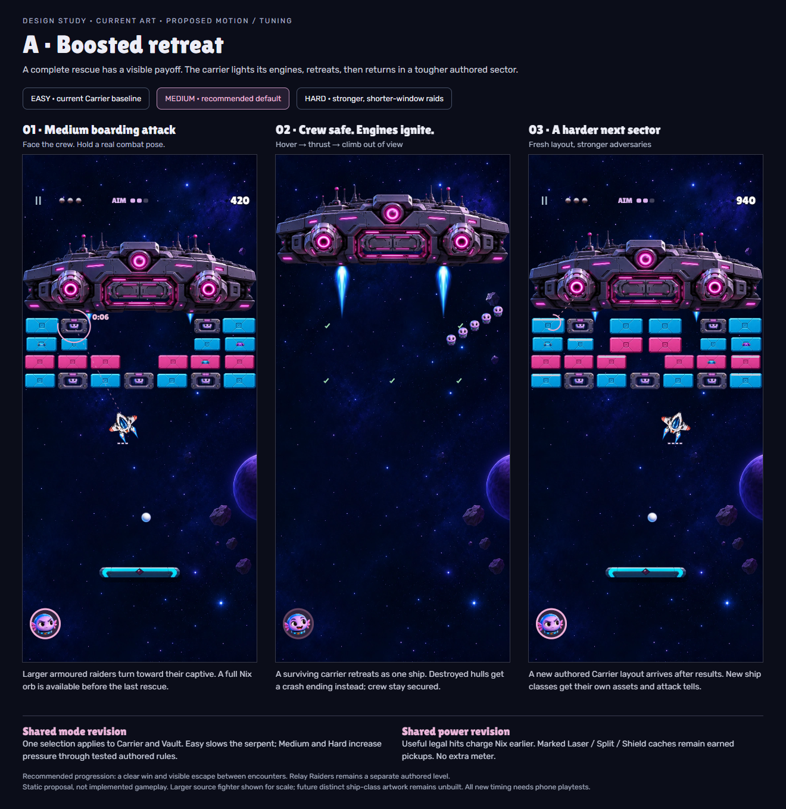
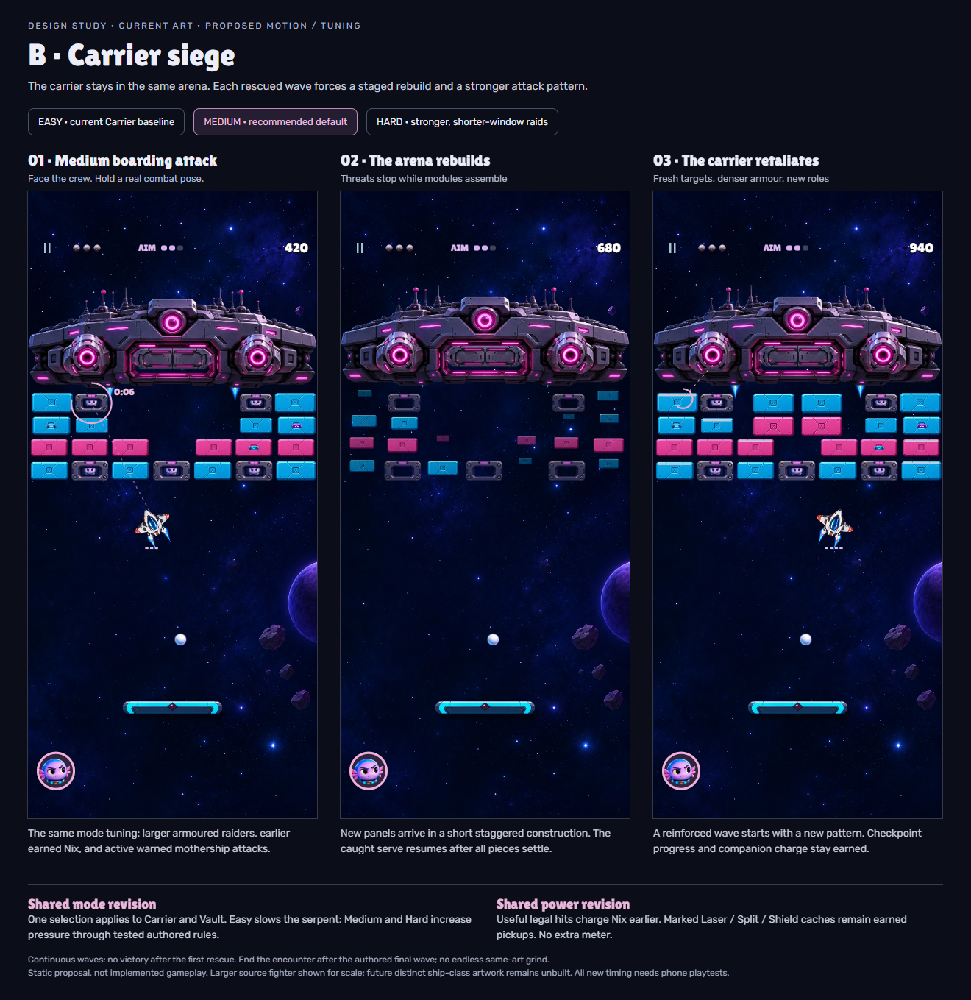

# Carrier difficulty and progression studies

2026-10-18. The owner finds current Carrier BA5E851F… too easy and current Vault too hard. This is new feedback, not approval to commit/push. The selected Boarding Raid loop remains; Easy/Medium/Hard, earlier Nix and meaningful boss/fighter motion need revision. No live mechanics, build or frozen APK was changed by these studies.

## Shared changes proposed in both boards

- Current Carrier enemy settings become Easy. Proposed Medium default and Hard use stronger locks/raiders, shorter extraction/recovery windows and readable hovering targets. Exact provisional table and source audit: `difficulty-modes.md`. Human balance remains unverified.
- Current Vault becomes Hard, with Easy0.60 / Medium0.80 / Hard1.00 locomotion and chewing multipliers. Do not scale the ball, controls, venom warnings or capture/strike tells.
- Nix keeps one meter. Six genuine damaging player contacts can include partial locks and defensive hits; enemy damage, overkill, lingering overlap, Nix's powered hits and linked gun/hull double credit cannot farm it. Laser/Split/Shield caches stay genuine catchable drops.
- Source fighter points down. During boarding its nose rotates toward its captive using the wrapped target angle; bank/departure face their travel direction. Thrusters, muzzle, tractor mount and collision transform follow the same pose. Never flip only the art. The studies show a48×40u source fighter for scale; new distinct ship-class art is not built.
- The whole mothership, bay, guns and colliders share a hover transform. Reuse approved thruster effects with registered engine attachments. Hits must visibly recoil/flash/change state; no decorative ship that silently ignores damage. One hostile warning/projectile budget and the lower reaction lane remain requirements.

## A — Boosted retreat (recommended)

Every five-crew encounter has a clear rescue win. A surviving carrier flares both underside boosters, accelerates up and exits continuously. A hull defeated beforehand disables attacks and uses a damaged/crash departure instead; it does not resurrect. Crew identities remain secured through the presentation. Pause/result/ad clocks cannot advance the next stage. A short skippable presentation leads to results, then a fresh authored sector with stronger patterns and layout. Relay Raiders remains a separate level; this study does not silently replace it with more Carrier waves.

## B — Carrier siege

The same arena runs a finite authored sequence of waves. Between waves, threats/physics stop, the ball is safely caught, and independent panels assemble in a short stagger. Only after modules settle may the next serve begin. Earned charge, consumed rewards and secured identities cannot be reset/farmed. Wave-specific guns/modules can be replaced, but a destroyed main hull cannot magically refill; final main-hull defeat ends its attacks. The exact final-win/checkpoint rule must be agreed before implementing this option. This is a larger encounter/progression change than A.

## Evidence and boundaries

`node tools/carrier-difficulty-preview/build.mjs` captures both three-state boards from approved current artwork. It checks every image decoded, zero page errors, captive-facing orientation and expected retreat/rebuild state, then verifies hashes of Carrier/Arena/Vault/main/packed art/dist stayed unchanged. Output and receipts: `out/carrier-difficulty-options/`. Canonical PNGs above are1320px wide and contain no metadata. They are static design studies, not motion, collision, tuned difficulty or completed new ship-class proofs.

Await owner selection. After implementation: unit checks for mode values/resource ownership, every new moving collision transform, ordinary-only full clears and failures on both phone sizes, actual Nix use before the end, real pause/Continue/transition input and human mode testing. Screenshots/owner OK still precede new gameplay commit/push.
