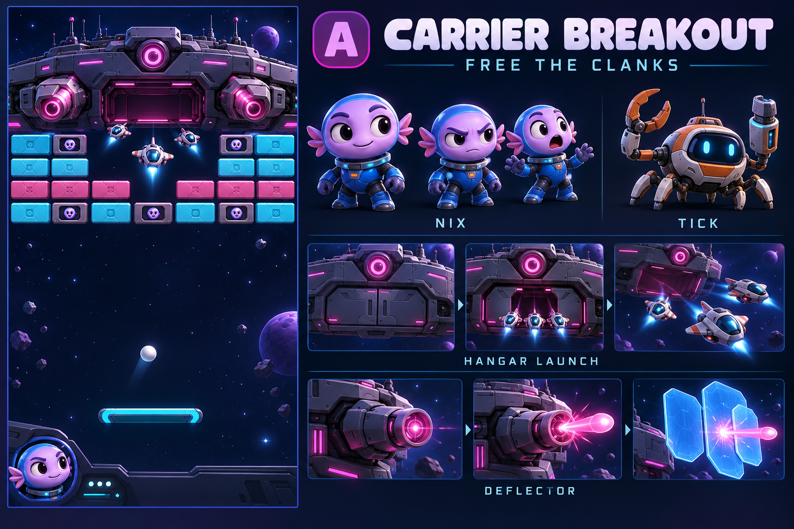

# Space mode: two proposed directions

**Latest review state:** all four polished space boards are approved as levels; A/B LEFT-playfield assets are production first. Companions/pilots/portraits are frozen, and no additional board choice is pending. See `space-direction-review.md` and `space-assets-ab-spec.md`. Native saucer-proxy 113/97-cell studies, their HP/deadlines and earlier B-only cast selections below are historical, not current geometry or mechanics approval. Current tested EA839F00… runtime is unchanged; no new encounter/build/APK is claimed.

**A/B asset proof:** the approved left-playfield PNG/Canvas-motion tranche is complete, with actual 393×852/412×915 captures and A/B motion GIFs under `out/space-assets-ab/final/`. See `space-assets-ab-spec.md` and `art/space/ASSETS_AB.md`. Companions stay frozen. No new encounter runtime, packed WebP family, collision/gameplay/balance or APK is implied; discarded layout rules below remain history.

Historical status below: the earlier B-only selection and companion/mechanic proposals are retained for context. Both A/B and C/D polished boards are now approved as levels, with A/B left assets first and companions frozen. Existing Invasion still uses its 11×9 formation and Zorvax mothership; no new space encounter is implemented.

The story stays inside the Menagerie: Zorvax has stolen Brickhaven's workers and other worlds' creatures. Hits free hijacked Clanks; they are rescued, not destroyed. Lumi and Kit's rescue remains the main thread. The new pilots and helpers below are proposed roles, with their exact place in the story awaiting the owner's choice.

## A — Carrier Breakout

**Purpose:** break the carrier's control network and free the hijacked Clanks aboard it. The ship is a physical opponent: hangar doors open, fighters leave the bay, cannons track and recoil, and armour exposes vulnerable hardware. This gives the familiar ball-and-paddle play an obvious rescue objective and a machine whose actions explain the danger.

**Nix** is the short-armed, gill-finned pilot. Keep the compact arms, broad expressive face and gill silhouette; do not stretch the character into another long-arm body. **Tick** is a six-legged crab mechanic with separate tool pincers. Tick plants its feet, scuttles to a mechanism and physically works on it. A tool arm is not an extra walking leg. Their proposed ally roles are pilot and rescue mechanic, while the carrier's hijack system controls its weapons.

**Earned tool — Deflector:** a proposed starting rule is one full core earned from 12 legal brick breaks. Spending it deploys two tangible ship plates for one telegraphed cannon volley, redirecting that volley toward exposed carrier hardware. The normal ball remains the main rescue tool. Clear dodge lanes and ordinary ball damage must make the encounter winnable without spending this power. This would be a mode-specific use of the single charge resource, replacing Titan for this loadout rather than granting both for free. Values and reflection damage need a playable test.

| Actor / mechanism | Anticipation → action → recovery | Readable consequence |
|---|---|---|
| Nix | Eyes follow the threatened lane; short hands brace the console → commits the deflector control → relief or worried glance as play continues | Expressions acknowledge the actual outcome, rather than looping a celebration through danger. |
| Tick | Six feet plant and tool opens → pincer turns a latch or braces a plate → tool retracts, feet resume a crab gait | A visible mechanism changes because Tick worked on it. |
| Carrier hangar / fighters | Door bolts disengage and bay opens → fighters move through the opening under thrust → doors close after the final fighter clears | Enemies originate from the ship; none appears from empty space. |
| Cannons / deflectors | Barrel tracks a marked lane and compresses → shot fires with recoil / plates rotate into place → barrel and plates settle | Aim warning, firing and reflected impact have separate silhouettes; no continuous connecting beam. |
| Freed Clank | Control light fails → dizzy release / fall into a rescue route → leaves safely | The player sees a worker rescued, not an explosion suggesting death. |

**Five-stage pilot arc:** 1) teach Clank rescue with an open, stationary bay; 2) add one slow cannon and generous lane warning; 3) introduce a small fighter launch, followed by a clear breather; 4) alternate armour exposure with a cannon volley and teach the earned deflector; 5) test those known patterns against the carrier's control core. Increase angle choice and overlapping decisions before adding health. Never close every safe lane during a compulsory volley.

## B — Relay Raiders

**Purpose:** open the Menagerie's escape relay and release captured research drones. This is a moving-lock rescue puzzle under cannon pressure, rather than another marching formation. The gate's physical rings and locks show how close the escape route is to opening.

**Vesper** is an actual quadruped piloting a skiff: four weight-bearing paws, a low spine and a steering tail. Cockpit controls must suit that anatomy; no hidden humanoid body or human-arm substitute. **Latch** is a compact lockfish swimming inside a buoyant water field. Fins brake and steer; the jaw clamps a real lock. The contained water field gives the fish a clear reason to swim in space, with a deforming boundary and droplets kept away from gameplay-critical silhouettes.

**Earned tool — Clamp:** fill the same single mode-specific core through legal breaks, then ask Latch to hold one moving lock still for a complete opening cycle. A clean ball hit during that opening releases its drone and advances the gate. The lock must also be hittable through ordinary timing, so the tool improves a hard opportunity rather than supplying a mandatory purchased key. It does not freeze the ball, all enemies or the whole level.

| Actor / mechanism | Anticipation → action → recovery | Readable consequence |
|---|---|---|
| Vesper / skiff | Four paws brace, ears aim and tail counterbalances → skiff banks / collects a freed drone → paws settle and tail returns | The cockpit moves with a real quadruped, not a floating portrait. |
| Latch / water field | Tail gathers, fins flare and eyes fix on the lock → swims, bites and holds → jaw releases, tail drives the return | One specific lock stops; the water remains a local habitat, not a screen-wide magic wash. |
| Moving locks / gate | Lock travels along its visible rail → ball releases it → gate segment rotates and stays open | Persistent progress is visible even after a missed next shot. |
| Relay cannon / drone | Sweep lane warns → cannon fires and recoils / cage opens → cannon resets and drone exits toward the skiff | Warning, danger and rescue cannot be mistaken for one another. |

**Five-stage pilot arc:** 1) release a drone behind a stationary lock; 2) learn a single moving lock with a wide opening; 3) add a slow cannon sweep, then a rescue breather; 4) introduce Latch's earned clamp and two alternating lock routes; 5) open the escape gate using those established patterns while managing one clearly warned sweep. Gate progress persists within the encounter; missed timing must offer another cycle instead of a softlock.

## Production and progression limits

These five-stage sketches are proposed test arcs, not a silent revision of the story plan's six-stage chapter structure. Target short encounters with a teach → practice → twist → test rhythm. First block out shot lanes, warning lengths, safe returns and native phone footprints; prove a baseline clear before decorating or increasing pressure. Any suggested 12-break cost is a tuning starting point, not an approved balance value.

| Direction | Reusable foundation | New proof required before a full batch |
|---|---|---|
| A | Current ball/paddle, brick damage, Clank rescue identity and glossy material language; mechanical hinges are straightforward to author | Nix's continuous face/gills and short-arm rig; Tick's six-legged support gait and independent tools; actual door clearance, fighter launch, cannon recoil and plate deployment. No suitable finished Nix/Tick production rig is claimed. |
| B | Current ball/brick foundation; locally inspected Cat quadruped and Piranha fish sources described in `03-cast-restart.md` | Vesper's four-paw cockpit fit and tail clearance; Latch's jaw/fin deformation and bounded water field; moving-lock collision, repeated legal openings and gate state. Source import success does not prove the restyled faces or new clips. |

Both boards are generated appearance/story concepts, **not finished meshes, working clips, native-size screenshots or gameplay proof**. After a pick, show actual selected-source geometry, three contrasting expressions and short mechanism/locomotion clips before rendering a large family. Keep faces readable, contacts grounded, pivots stable and motion bounds clear of the ball, paddle and controls. The current gameplay face control remains a face; a space cast must not quietly replace it with a miniature body.

**Brum has an independent castle progression.** His heavy arms should earn dedicated planted smash, impact, recovery and protective brace actions in strong-arm levels: teach a readable breakable obstruction, practice choosing a safe strike window, then combine known threats into a demanding but fair route. Do not reduce him to a space reskin or make every obstacle require repeated health grinding. Every level must be winnable with earned baseline tools. Future paid options may offer optional tactics or convenience alongside a route obtainable through play; no payment-only rescue gate, required hero purchase or forced energy wait is proposed. Those progression/store systems are not implemented by this document.

The owner selected B. Actual-source Vesper/Latch proof is next; this document alone adds no gameplay, finished production asset, chapter, save or store system.
